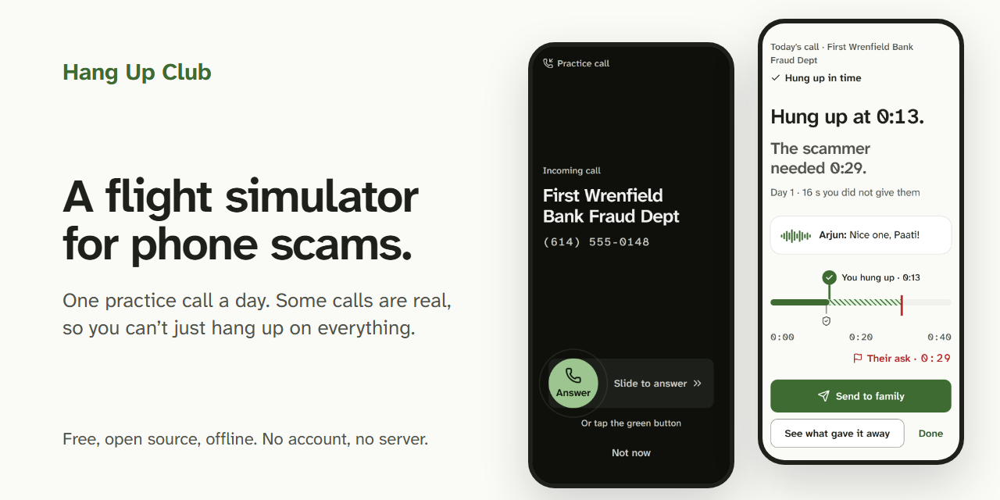
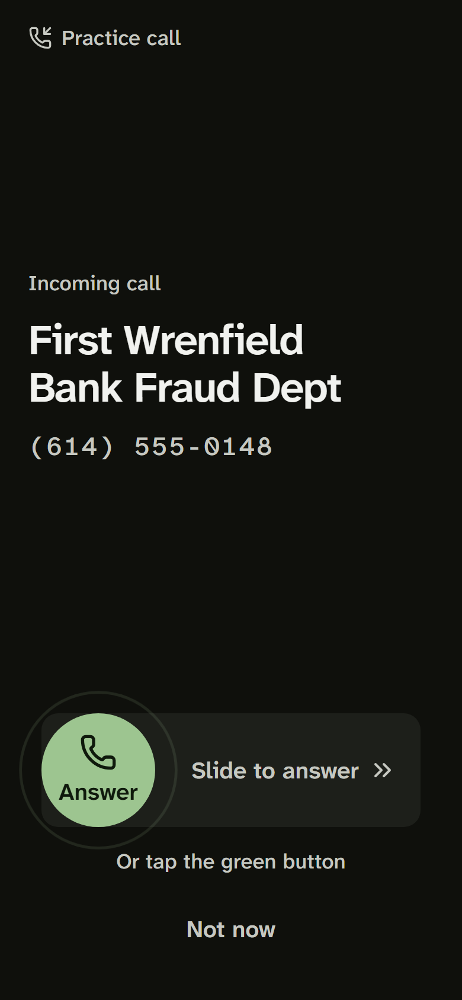
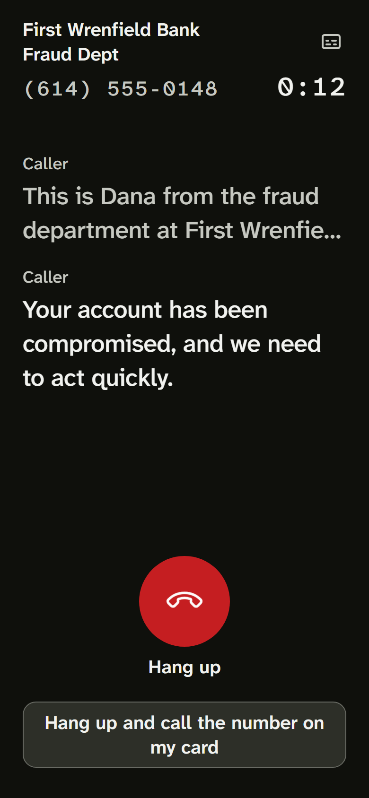
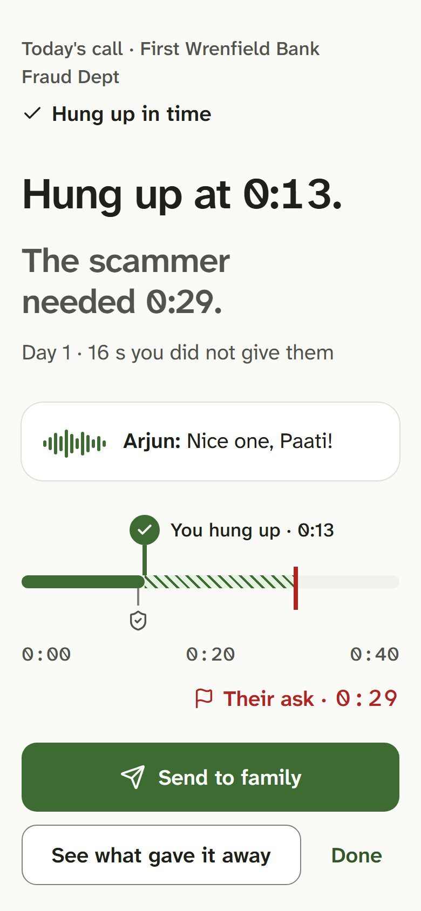
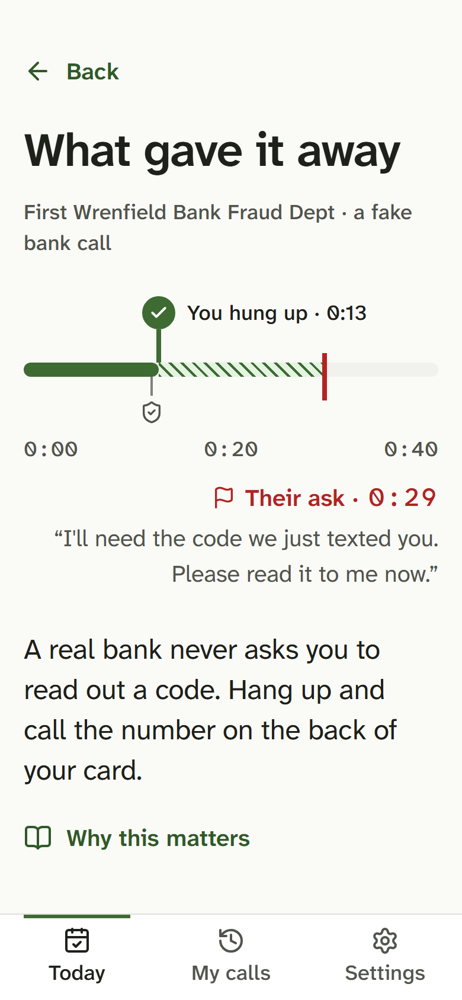

# Hang Up Club

A flight simulator for phone scams, built for older adults: one realistic practice call a day, and some of the
calls are real, so the skill it trains is judgement, not reflex.

[](LICENSE)



The phone rings. "First Wrenfield Bank Fraud Dept." A calm voice says your account has been compromised and asks
for the code they just texted you. You hang up at the first warning sign, and the app shows you exactly where you
cut the line and when the scammer would have asked. Tomorrow's call might be the pharmacy saying your refill is
ready, and hanging up on that one is a miss.

A family member (the "coach") can set it up by link, send a recorded cheer and write their own practice call.
There is no account and no server: everything stays on the phone.

**This is practice, not protection.** Hang Up Club cannot screen, block or detect real calls. If a real call
worries you, hang up and call a number you already trust, like the one on the back of your card.

| Incoming call | In the call | Result | What gave it away |
|---|---|---|---|
|  |  |  |  |

## Install it

Hang Up Club is an installable web app (PWA). It works offline once installed.

- **Android (Chrome):** open the app's address, then tap **Install** when the app offers it, or the browser menu
  (three dots) and **Install app**.
- **iPhone and iPad (Safari):** open the app's address, tap **Share**, then **Add to Home Screen**. The app shows
  an illustrated guide for this.
- **Desktop (Chrome or Edge):** click the install icon at the end of the address bar. Safari on a Mac: **File**,
  then **Add to Dock**.

To run it from source, see [Development](#development). The landing page lives in [`site/`](site/README.md).

## How it works

1. **One scored call a day.** A seeded daily scheduler picks the call on the phone itself. About 40% of calls are
   legitimate decoys (any 30 days hold 35 to 45%), with no more than 3 scams or 2 real calls in a row.
2. **20 call scripts, 1,317 variants.** 12 scam patterns (bank, government, grandchild in trouble, tech support,
   delivery, utility, prize, romance and more) and 8 real calls (pharmacy, clinic, dentist, library, a real bank
   alert), each a YAML template whose variables expand into many calls. Every scam pattern cites an FTC or FBI
   IC3 report ([`scenarios/SOURCES.md`](scenarios/SOURCES.md)).
3. **Scored on judgement.** Each script marks its first warning sign and the moment the scammer asks. Hanging up
   between the two scores best; hanging up before any warning is "early"; staying on a scam until the ask is
   "caught"; hanging up on a real call is a miss. "Hang up and call the number on my card" scores well on a scam
   after the first warning, and half on a real call that asked for nothing. Simulated over 1,000 days, hanging up
   on every call at once scores a judgement rate of about 0.30, calling back on every call at once at most 0.65, calling
   back on every call after the first warning below 0.9, and listening for the warning sign at least 0.95
   (`tests/unit/scoring.test.ts`).
4. **The replay** shows a timeline of the call with each tactic stamped ("They're rushing you", "Asks for a code")
   and one sentence of advice.
5. **Missed tactics come back.** Tactics from a call you were caught on are scheduled again sooner (spaced
   repetition), and a gentle streak allows one rest day a week.
6. **The coach loop.** A setup link (and QR code) sets what callers call the player and which scam types to
   practise. A cheer link carries a 2.5-second recorded cheer that plays after the player's next good hang-up. A
   family-call link carries a call the coach wrote. After a call, the player can send a result card back by link.

Voices are pre-rendered at build time with local text-to-speech, band-passed to sound like a phone line, and
shipped as about 3.7 MB of Opus audio, so calls start at once and work offline.

## Privacy

- **Everything stays on the device.** Profile, settings, calls, streak, cheers and family calls are stored in the
  browser's IndexedDB. The only thing in `localStorage` is the theme, so the first paint has the right colours.
- **No account, no server, no analytics, no error reporting, no cloud voices.** Fonts and audio are the app's own
  files. Web Speech (used only when a clip cannot play) is restricted to the phone's built-in voices.
- **Links carry their data in the URL fragment** (`#...`), which browsers never send to a server. A result leaves
  the phone only when the player taps "Send to family".
- **The microphone** is used only on the coach's "Record a cheer" step, after a tap, for at most 2.5 seconds.

**How this is tested.** Every end-to-end test fails if any request leaves the app's own origin
(`tests/e2e/fixtures.ts` watches every request; the landing-page tests do the same), and a Content Security Policy
with `connect-src 'self'` is injected into the production build. The service worker caches only same-origin files.
"Delete everything on this device" in Settings removes all of it.

## Safety

The scripts show the shape of scams that the FTC and FBI already describe in public advice: urgency, secrecy,
gift cards, "safe accounts", remote access, codes read over the phone. They do not teach new techniques, and every
scam ends with one sentence naming the safe action. Every bank, agency, shop and person is made up, and every phone
number is in the 555-01xx range reserved for fiction; `pnpm check` blocks a list of about 300 real institutions,
and new names are checked by hand ([`scenarios/NAMES-REVIEW.md`](scenarios/NAMES-REVIEW.md)). The legitimate calls
ask for nothing, except the real bank alert, which tells you to hang up and call the number on your card.

## Limitations

- **Tested in Chromium only.** No WebKit (iPhone Safari), Firefox or real phone has run the test suite. iOS audio
  unlock, the AAC fallback, Add to Home Screen, finger slide-to-answer and vibration are untested on devices.
- **Nobody has listened to all the audio.** The 418 clips are checked by machine (every clip present, current
  and within the size budget; the filter measured on a test tone), not by ear. The voices are Windows SAPI voices (Microsoft David and
  Zira) and sound dated. Whether Microsoft's terms allow shipping audio made with them has not been checked; see
  [`public/audio/CREDITS.md`](public/audio/CREDITS.md).
- **The phone-line filter** cuts 20 dB above 4 kHz but only 9 to 19 dB between 100 and 190 Hz (the spec asks for
  20 dB below 200 Hz).
- **Family calls have no rendered voice.** They play through the phone's built-in Web Speech voice, or as
  captions only. The planned in-browser voice pack is not built.
- **A PWA cannot ring like a real phone.** The call rings when the player opens the app; daily reminders are an
  `.ics` calendar file, which has not been opened in a real calendar app.
- **Links are not signed.** Anyone can make a family-call or result link; the app labels who wrote a call and says
  a result link is not proof.
- **English only**, apart from a few ways callers address the player (Paati, Abuela, Oma, Lola and others).
- **The signature animation** is gated at 100 ms from the press to the first shard in tests, against a 40 ms target
  (it measured 10 to 45 ms on a shared test machine).

The full list, with the test for every acceptance criterion, is in [`HANDOFF.md`](HANDOFF.md).

## Add a scenario

Copy a template in `scenarios/scam/` or `scenarios/legit/`, edit it, then run `pnpm scenarios:build`,
`pnpm audio:render` and `pnpm check`. The format, the rules for what a script may contain, and how names are
cleared are in [CONTRIBUTING.md](CONTRIBUTING.md#how-to-write-a-scenario-yaml).

## Development

Node 24 and pnpm 10.

```sh
pnpm install
pnpm exec playwright install chromium   # once, for the end-to-end tests
(cd site && pnpm install)               # once: the e2e run also builds the landing page

pnpm dev            # http://localhost:5173 (the service worker is off in dev)
pnpm build          # the installable app in dist/; serve it with any static host
pnpm lint && pnpm typecheck && pnpm test && pnpm check
pnpm exec playwright test --workers=1
node scripts/capture-launch.mjs        # after pnpm build: the screenshots in docs/launch/
```

| Path | What |
|---|---|
| `src/domain/` | Pure TypeScript: scenario expansion, timeline, scoring, scheduler, streak, links |
| `src/storage/`, `src/state/`, `src/audio/` | IndexedDB, application state, the Web Audio call engine |
| `src/ui/`, `src/app/` | React screens, components and the call orchestration |
| `src/sw.ts` | The service worker |
| `scenarios/` | The call scripts, their sources and the name review |
| `scripts/` | Scenario compiler, name and token checks, text-to-speech renderer, screenshot tools |
| `site/` | The landing page (separate static package) |
| `tests/` | Vitest unit tests and Playwright end-to-end tests |
| `SPEC.md`, `DESIGN.md`, `docs/adr/` | What it does, how it looks, and why it is built this way |

To host it, serve `dist/` from any static host with HTTPS, and send `Content-Security-Policy: frame-ancestors
'none'` as a header (it cannot be set in a meta tag).

## Contributing

Contributions are welcome, especially new scenarios and real-device testing. Read
[CONTRIBUTING.md](CONTRIBUTING.md), the [Code of Conduct](CODE_OF_CONDUCT.md) and the
[security policy](SECURITY.md).

## License

[MIT](LICENSE). Scenario sources are cited in [`scenarios/SOURCES.md`](scenarios/SOURCES.md); audio credits are in
[`public/audio/CREDITS.md`](public/audio/CREDITS.md).
